# Selling to shops and franchisees — B2B partners

**Audience:** whoever runs the bakery day to day (you, or a family member
covering for you).
**Time to read:** 25 minutes. **Time to set up a partner:** about 5 minutes.
**Prerequisites:** nothing. Retail ordering keeps working exactly as before
whether or not you ever open this module.

> **In one line:** a *partner* is a shop you supply. A *contract* holds the
> prices you agreed with them. A *B2B order* is a normal order that uses
> those prices instead of retail prices.

---

## Contents

1. [Should you use this module?](#1-should-you-use-this-module)
2. [The words you will see](#2-the-words-you-will-see)
3. [The five-minute setup](#3-the-five-minute-setup)
4. [Contracts and price lists](#4-contracts-and-price-lists)
5. [Two ways to price a partner](#5-two-ways-to-price-a-partner)
6. [Taking a B2B order](#6-taking-a-b2b-order)
7. [What the warnings mean](#7-what-the-warnings-mean)
8. [After the order: production, dispatch, invoice](#8-after-the-order-production-dispatch-invoice)
9. [Getting paid and chasing credit](#9-getting-paid-and-chasing-credit)
10. [Is this partner worth it?](#10-is-this-partner-worth-it)
11. [A worked example, end to end](#11-a-worked-example-end-to-end)
12. [What the system will and will not do](#12-what-the-system-will-and-will-not-do)
13. [Troubleshooting](#13-troubleshooting)
14. [Monthly routine](#14-monthly-routine)

---

## 1. Should you use this module?

Use it when **another business** buys from you on agreed terms. Typical
cases:

- A café or sweet shop that takes 10 brownie boxes every Friday.
- A franchisee who sells your cakes under your brand and keeps a cut.
- A distributor who wants a quantity discount.

Do **not** use it for:

- A regular retail customer who happens to order a lot. Keep them as a
  customer; the retail flow already handles repeat orders.
- A one-off bulk order at a negotiated price. Make it a retail order and
  adjust the price later if you must — a contract for one order is
  paperwork you will regret.

The module is invisible until you add your first partner. Nothing on the
retail screens changes.

---

## 2. The words you will see

| Word | What it actually means |
|---|---|
| **Partner** | The shop or franchisee. Has a short code (e.g. `SWEET-BAN`) used on every screen. |
| **Kind** | Shop, Franchisee or Distributor. Only a label today — it groups partners in reports. |
| **Contract** | The agreed prices, with a start and end date. You can have several; only one applies on a given day. |
| **Price list** | The rows inside a contract: product + "from how many" + the rate. |
| **Slab** | A price that only applies from a certain quantity. "₹780 each, but ₹740 each from 10 up" is two slabs. |
| **Commission** | The other way to price: the partner sells at your MRP and keeps a percentage. You invoice MRP minus that cut. |
| **MRP** | The retail price on the product (`products.base_price`). Never overwritten by wholesale rates. |
| **Minimum order value** | The smallest order you accept from that partner. Below it you get a warning, not a block. |
| **Cut-off** | The time after which an order counts as next day's work. |
| **Lead time** | How many hours' notice the partner must give. |
| **Dispatch days** | The weekdays you deliver to them (e.g. Mon/Wed/Fri). |
| **Credit days** | How long they have to pay. `0` means pay on delivery. |
| **Credit limit** | The maximum unpaid balance you are willing to carry. **It only warns.** |
| **Outstanding** | What they owe you right now: unpaid balances across their open orders. |
| **PO reference** | The purchase-order number from *their* system, printed on the invoice so their accounts team can match it. |
| **Statement** | A one-page list of what you billed, what they paid, and what is left. |
| **Production mode** | `Shared with retail` (default) or `Dedicated line`. Recorded per order so you can change your mind later without rewriting history. |

---

## 3. The five-minute setup

### 3.1 Open Partners

**More → 🏪 Partners.** Empty the first time.

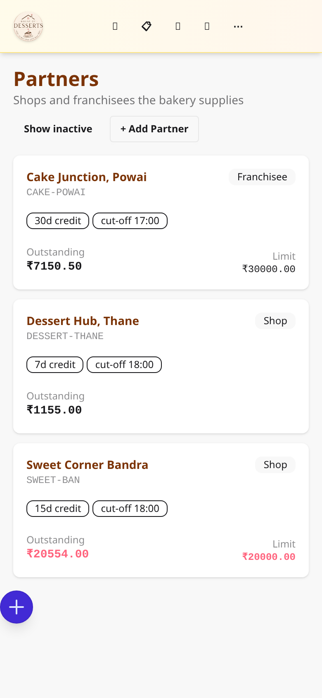

Each card shows the partner, its code, credit days, cut-off time, and
what they owe. The amount turns **red when they are over their credit
limit** — that is the only alarm this screen raises.

### 3.2 Add the partner

Tap **+ Add Partner**.

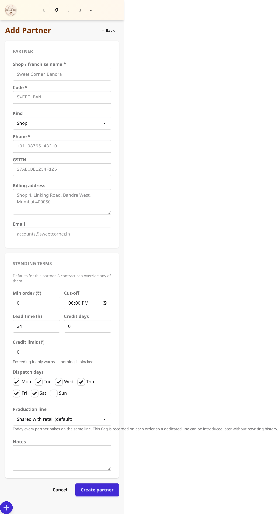

Fill in:

| Field | Notes |
|---|---|
| **Shop / franchise name** | Exactly as you would say it. This is what appears on their invoices. |
| **Code** | 3–20 characters, letters/numbers/dashes. Use something you can say on the phone: `SWEET-BAN`. Must be unique. |
| **Kind** | Shop / Franchisee / Distributor. |
| **Phone** | Required — it becomes their billing contact. If a customer with this phone already exists, the partner is linked to them instead of creating a duplicate. |
| **GSTIN** | Their GST number. Needed on their invoice so they can claim input credit. Leave blank if they are not registered — you will get a reminder warning on credit orders. |
| **Billing address** | Printed on the invoice. |
| **Min order value** | Your rule, e.g. ₹2000. |
| **Cut-off** | e.g. `18:00`. |
| **Lead time** | Hours of notice, e.g. `24`. |
| **Credit days** | `0` = pay on delivery, `15` = fifteen days. |
| **Credit limit** | The unpaid balance you are willing to carry. `0` means "no limit set". |
| **Dispatch days** | Tick the days you deliver. |
| **Production line** | Leave on *Shared with retail* unless you are genuinely giving them their own bake slot. |

Tap **Create partner**. You land on their page.

### 3.3 What the partner page shows

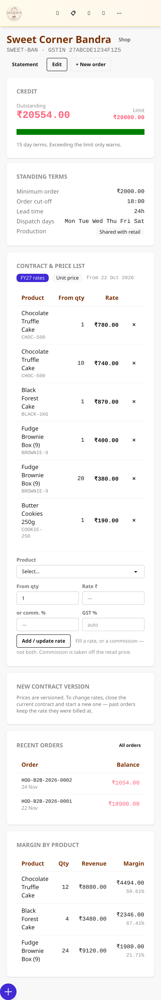

From top to bottom:

1. **Credit** — outstanding, limit, and a bar that fills as they approach
   the limit. Red means over.
2. **Standing terms** — the defaults you just entered. A contract can
   override the minimum order, credit days and credit limit.
3. **Contract & price list** — empty until you create a contract (§4).
4. **Recent orders** — their last ten, with PO and balance.
5. **Margin by product** — what you actually made on each item (§10).

Three buttons at the top: **Statement**, **Edit**, **+ New order**.

---

## 4. Contracts and price lists

A **contract** is a dated envelope around prices. Everything inside it is
a **price list**.

### 4.1 Create the first contract

Open the **New contract version** panel at the bottom of the partner page
and tap it open.

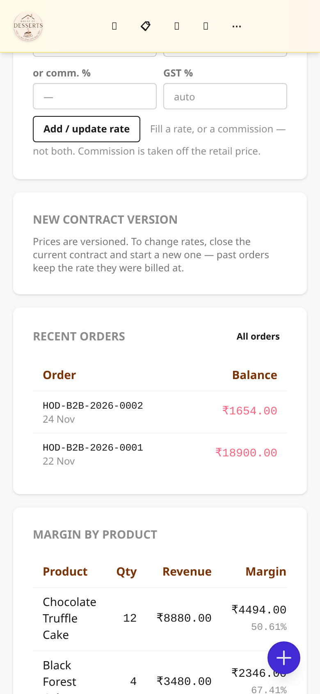

| Field | What to put |
|---|---|
| **Label** | Something you will recognise later: `FY27 rates`, `Franchise agreement 2026-27`. |
| **From** | The day the prices start. Today is fine. |
| **To** | Leave blank for "until further notice". Set an end date when you know the agreement renews. |
| **Mode** | `Unit price` or `Commission` — see §5. |
| **Default comm. %** | Only for Commission mode. Every product without its own rate uses this. |

Tap **Create contract**. The contract badge appears at the top of the
price list.

### 4.2 Add prices

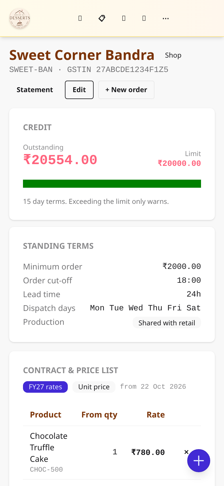

Use the row of fields under the price list:

1. Pick the **product**.
2. **From qty** — `1` for "any quantity". Add another row at `10` for the
   bulk rate.
3. Fill **Rate ₹** *or* **comm. %** — never both.
4. **GST %** — leave blank to use the product's own GST rate.
5. **Add / update rate**.

Adding the same product and "from qty" again **updates** that row instead
of creating a duplicate. The **✕** button retires a rate (it is kept in
the audit log, not deleted from history).

### 4.3 Changing prices later

**Never edit an old contract.** Close it and open a new one:

1. Edit the old contract and set its **To** date to yesterday.
2. Create a new contract starting today with the new prices.

Why: every order stores the contract it was priced under. If you edit a
contract in place, last quarter's revenue and any re-printed invoice stop
matching what the partner was actually charged. A new contract keeps
history honest and takes ten seconds.

---

## 5. Two ways to price a partner

### 5.1 Unit price (most common)

You agree a rate per product, optionally cheaper at volume.

| Product | From qty | Rate |
|---|---|---|
| Chocolate Truffle Cake | 1 | ₹780 |
| Chocolate Truffle Cake | 10 | ₹740 |
| Fudge Brownie Box (9) | 1 | ₹400 |
| Fudge Brownie Box (9) | 20 | ₹380 |

Order 12 cakes → the system picks the **10+** slab → ₹740 each.

### 5.2 Commission (for franchisees and MRP-driven shops)

The partner sells at your MRP and keeps a cut. You invoice the rest.

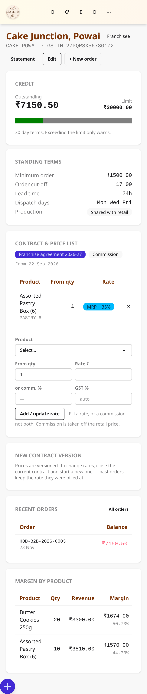

The price list shows a blue badge instead of a number: `MRP − 35%`.

Worked example — Assorted Pastry Box, MRP ₹540:

```
Partner's cut       35% of 540            = ₹189
You invoice         540 − 189             = ₹351
GST 5% on 351                             = ₹17.55
Line total                                = ₹368.55
```

Two rules worth knowing:

- Commission comes off the **taxable price**, before GST — not off the
  GST-inclusive amount.
- A contract in Commission mode still lets you give one product a
  **different** commission (e.g. 35% on pastries, the default 25% on
  everything else). That is what the per-product `comm. %` row is for.

### 5.3 Which to choose

| Situation | Use |
|---|---|
| Shop buys from you and resells at whatever price it likes | **Unit price** |
| Franchisee sells at *your* MRP and keeps a cut | **Commission** |
| Distributor with volume slabs | **Unit price**, several slabs |
| Partner has not decided yet | Start with unit price; switching is a new contract, not a migration |

### 5.4 What if a product has no rate?

It falls back to the **retail price**, and the order shows a warning:
*"No contract rate for: SKU — charged at retail price."* That warning is
your prompt to add the missing row, or a sign the partner is being
overcharged.

---

## 6. Taking a B2B order

### 6.1 Start the order

Two ways in — both end at the same form:

- From the partner page: **+ New order**.
- From **Orders → + New Order**, then flip the toggle at the top of the
  Customer card from **Retail** to **B2B partner**.

The toggle is the only difference between a retail and a B2B order.

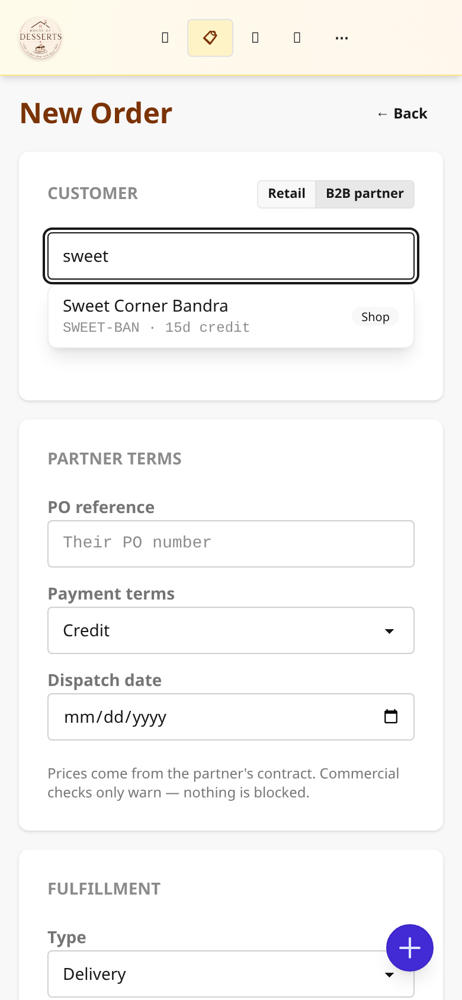

Type two or more characters of the shop name or code. Tap the result.
The line underneath confirms the choice and their credit terms.

### 6.2 Fill the partner terms

A **Partner terms** card appears:

| Field | Why |
|---|---|
| **PO reference** | Their order number. Appears on the invoice. |
| **Payment terms** | Credit / Advance / Cash on delivery. Advance resets credit days to 0. |
| **Dispatch date** | When you are sending it. Separate from "ready by" — that is when it leaves your kitchen. |

### 6.3 Add items and watch the prices

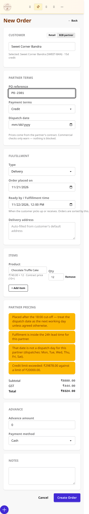

Add items exactly as you do for retail (type-ahead, quantity, **+ Add
item**). As soon as the partner and an item are both present, the
**Partner pricing** panel fills in by itself:

- Under each product: `₹740.00 × 12 · Contract price (10+)` — the rate,
  the quantity, and *why* that rate applied.
- At the bottom: Subtotal, GST, Total.
- In between: any warnings (§7).

The panel is a **preview**. The server re-prices the order when you save,
using the same rules, so the numbers you saw are the numbers stored.

### 6.4 Save

**Create Order.** The order gets a B2B number: `HOD-B2B-2026-0001`.
Retail orders keep their own series and are never affected.

In the orders list the partner name replaces the customer name and a small
**B2B** badge sits next to the number, so you can tell the two channels
apart at a glance:

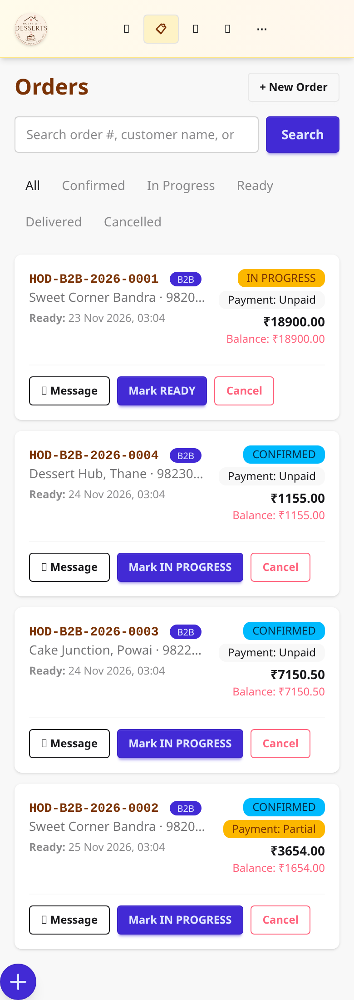

---

## 7. What the warnings mean

Warnings are advice. **Nothing is ever blocked** — the order saves with
the warnings attached, so you can see later why it was flagged.

| Warning | Meaning | What to do |
|---|---|---|
| *Below the agreed minimum order value of ₹2000 (this order is ₹1155).* | The partner's contract sets a floor. | Top up the order, or accept it knowingly. |
| *Placed after the 18:00 cut-off — treat the dispatch date as the next working day.* | It arrived late in the day. | Move the dispatch date, or confirm with them. |
| *Fulfilment is inside the 24h lead time for this partner.* | Not enough notice to bake comfortably. | Push the ready-by time, or start early. |
| *That date is not a dispatch day for this partner (dispatches: Mon, Wed, Fri).* | Their agreed delivery days. | Move the date, or make a one-off exception. |
| *Credit limit exceeded: ₹29,788 against a limit of ₹20,000.* | They are over their rope. | Decide: take payment first, or accept the risk. |
| *Partner has no GSTIN on file — the invoice will be raised without one.* | Their accounts team cannot claim input credit. | Ask them for the GSTIN and add it. |
| *No contract rate for: COOKIE-250 — charged at retail price.* | A product slipped through the price list. | Add the rate. |

The full list is stored on the order and visible on its detail page, so
the decision is never lost.

---

## 8. After the order: production, dispatch, invoice

### 8.1 It behaves like any other order

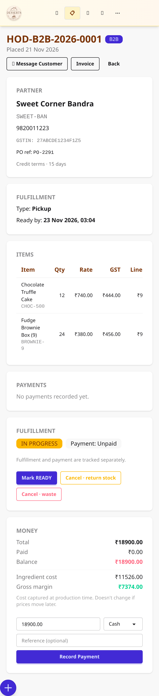

The order page shows a **B2B** badge, the partner instead of a customer,
their GSTIN, the PO reference and the payment terms. Everything else —
status buttons, ingredient deduction, COGS, WhatsApp messages — is
identical to retail.

**Production is shared.** A partner order appears in **Today** with a
B2B badge, so the kitchen sees it next to retail work:

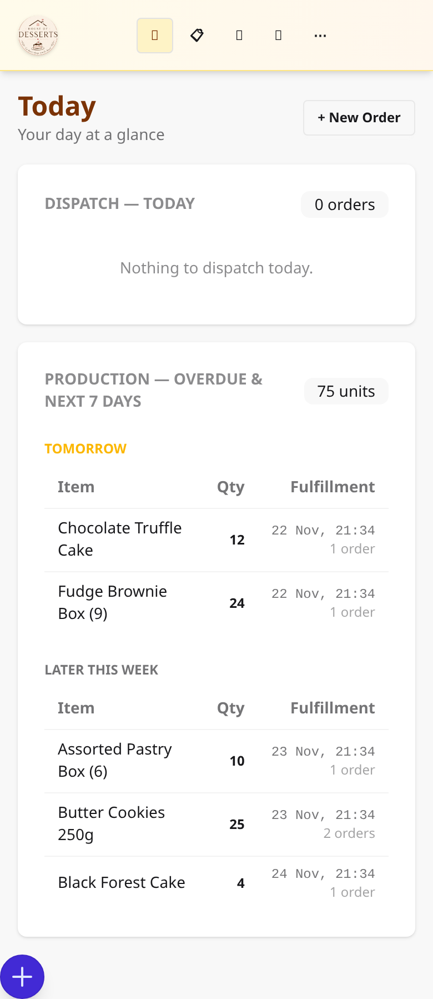

Starting production (`IN PROGRESS`) deducts ingredients from the same
stock, using the same recipes. There is no separate B2B inventory.

### 8.2 The invoice

Tap **Invoice** on the order. The preview (and the PDF) now carries:

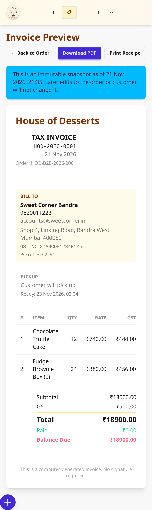

- The **partner** as the buyer, with their address and phone.
- **GSTIN** — so they can claim input credit.
- **PO ref** — so their accounts team can match it to their purchase order.
- The B2B order number under "Order".

The invoice is a **snapshot**. Editing the partner or the contract later
does not change an invoice you already issued.

### 8.3 Retail orders are unaffected

No B2B badge, no GSTIN, no PO — exactly as before. The two channels share
one pipeline but never mix on a document.

---

## 9. Getting paid and chasing credit

### 9.1 Recording a payment

Same as retail: open the order → **Record Payment** → amount and method.
For a bank transfer put the UTR/NEFT reference in **Reference**.

Paying an order down reduces their **outstanding** immediately, on the
partner page and in the statement.

### 9.2 The statement

**Partner page → Statement.**

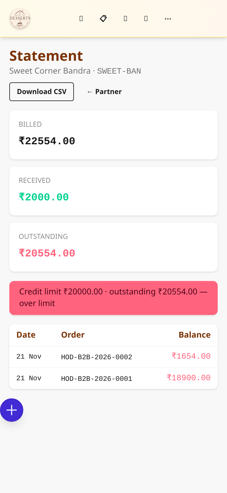

Three numbers at the top — **Billed**, **Received**, **Outstanding** —
then one row per order with its balance. If they are over their credit
limit, a red banner says so.

**Download CSV** gives you the same thing as a spreadsheet to email them.

### 9.3 The monthly chase

Once a month, for every partner with a balance:

1. Open their statement.
2. Download the CSV.
3. Send it with a short message: *"Statement for November — ₹20,554
   outstanding, of which ₹18,900 is order HOD-B2B-2026-0001."*

That is the whole credit-control process. There is no separate ledger to
reconcile: outstanding is calculated from unpaid orders every time you
look.

---

## 10. Is this partner worth it?

The partner page ends with **Margin by product**: for each product they
bought, the quantity, the revenue at *their* price, the recipe cost, and
the margin.

```
Revenue  = contract price × quantity sold
COGS     = recipe cost per unit × quantity
Margin   = Revenue − COGS
```

Example — Chocolate Truffle at ₹740 against a ₹366 recipe cost:

```
Revenue per unit     ₹740
Recipe cost          ₹366
Margin               ₹374   (50.6%)
```

Compare that to the retail price of ₹850 (margin ₹484, 57%) and you can
see exactly what the wholesale rate is costing you. That number — not the
order value — is what decides whether a partner stays.

If a margin looks like 100%, the product has **no recipe** entered. Add
the recipe under Products → Recipe and the real cost appears.

---

## 11. A worked example, end to end

The sample data used for the screenshots in this guide. Useful for a
training session: set it up once, then walk through it.

**Products:** Chocolate Truffle Cake ₹850, Black Forest Cake ₹950,
Fudge Brownie Box ₹450, Butter Cookies 250g ₹220, Assorted Pastry Box ₹540.

**Sweet Corner Bandra** — shop, 15-day credit, ₹20,000 limit, dispatch
Mon–Sat, cut-off 18:00, minimum order ₹2,000. Unit-price contract:

| Product | From qty | Rate |
|---|---|---|
| Chocolate Truffle | 1 | ₹780 |
| Chocolate Truffle | 10 | ₹740 |
| Fudge Brownie | 1 | ₹400 |
| Fudge Brownie | 20 | ₹380 |

**Order 1** — 12 truffles + 24 brownies:

```
12 × ₹740  = ₹8,880
24 × ₹380  = ₹9,120
Subtotal   = ₹18,000
GST 5%     = ₹900
Total      = ₹18,900        → HOD-B2B-2026-0001
```

Note the slabs: 12 cakes picked the **10+** rate, 24 brownies picked the
**20+** rate. That is the whole point of slabs — the bigger order earns
the better rate automatically.

**Cake Junction, Powai** — franchisee, commission contract at 25%, with
pastries at 35%:

```
Assorted Pastry Box, MRP ₹540, commission 35%
  → ₹351 each, 10 boxes = ₹3,510
Butter Cookies, MRP ₹220, contract default 25%
  → ₹165 each, 20 packs = ₹3,300
```

**Dessert Hub, Thane** — a partner with no contract yet. Every product
falls back to retail price and the order warns about it.

---

## 12. What the system will and will not do

**It will:**

- Keep retail prices untouched, always.
- Remember the price each order was placed at, forever.
- Warn you about minimums, cut-offs, lead times, dispatch days and
  credit limits.
- Put the partner's GSTIN and PO on the invoice.
- Tell you the margin per product for each partner.

**It will not:**

- Block an order for any commercial reason. You decide.
- Send the partner anything by itself. Statements are a download you
  choose to send.
- Keep a running credit balance in a separate ledger. Outstanding is
  computed from unpaid orders each time — one source of truth.
- Handle semi-finished supply (sponges, ganache) or a partner login.
  Both are future work, not features you are missing.

---

## 13. Troubleshooting

| Problem | Cause | Fix |
|---|---|---|
| The partner's rate is not being used | No contract covers today's date, or no slab for that quantity | Check the contract's From/To dates; check the "from qty" |
| An order shows retail prices | Partner selected but contract expired | Create a new contract starting today |
| "Partner code already in use" | Another active partner has that code | Pick a different code; the old one can be deactivated |
| "A contact phone is required" | Phone left blank | Add the shop's number |
| Can't find a partner in the order form | Typed fewer than 2 characters, or they are inactive | Type 2+ characters, or re-activate them |
| Credit limit warning but the balance looks right | Outstanding includes *all* their unpaid orders, not just this one | Check the statement |
| Margin shows 100% | The product has no recipe | Products → Recipe → add ingredients |
| Invoice has no GSTIN | Partner record has none | Edit the partner and add it; new invoices pick it up |
| Wrong rate on an old order | Contract was edited in place | Don't do that — close it and create a new version |

---

## 14. Monthly routine

Ten minutes, once a month, per partner:

- [ ] Open the partner page — is anything red?
- [ ] Download the statement CSV and send it if there is a balance.
- [ ] Check **Margin by product** — is any product now losing money?
- [ ] Look at recent orders — any repeated warning (cut-off, dispatch day)
      that means the terms no longer fit reality?
- [ ] If prices changed, close the contract and open a new one — never
      edit the old one.

Yearly, or when an agreement renews:

- [ ] New contract with the new rates.
- [ ] Review the credit limit against how they actually paid.
- [ ] Re-check the minimum order value against your own costs.

---

*Screenshots use sample data. See `docs/training/README.md` for the rest
of the training material and how to reproduce this demo.*
