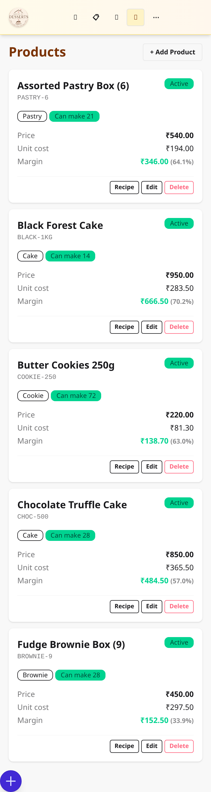
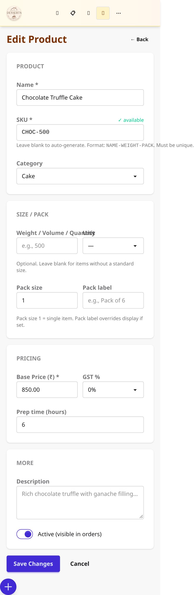
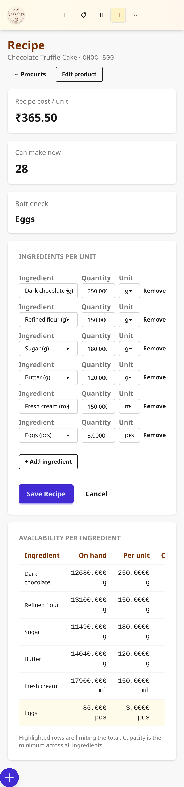
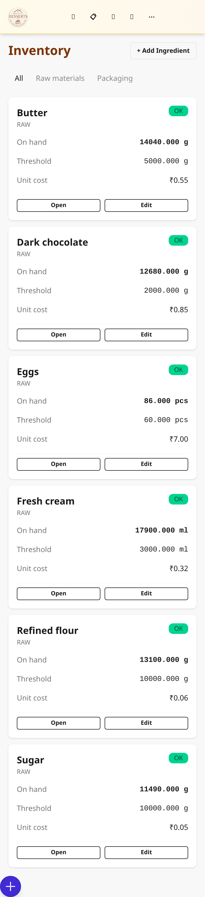
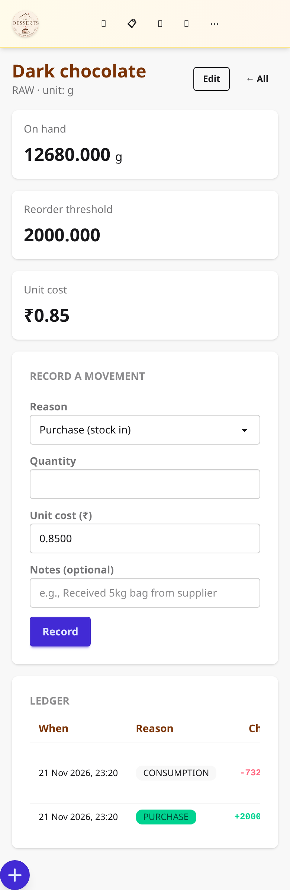

# Products, recipes and inventory

**Audience:** whoever decides what to sell and what goes into it.
**Time to read:** 20 minutes. **Time to add a product with a recipe:** 5 minutes.
**Prerequisites:** none — this is where you start.

> **In one line:** a product is what you sell; a recipe says what it costs
> you; the stock ledger says whether you can make it today. Those three
> numbers decide your price.

---

## Contents

1. [How the three pieces fit](#1-how-the-three-pieces-fit)
2. [Products](#2-products)
3. [Recipes](#3-recipes)
4. [Ingredients and stock](#4-ingredients-and-stock)
5. [Reading a stock ledger](#5-reading-a-stock-ledger)
6. [Capacity: can I make it today?](#6-capacity-can-i-make-it-today)
7. [A worked example](#7-a-worked-example)
8. [Troubleshooting](#8-troubleshooting)
9. [Monthly routine](#9-monthly-routine)

---

## 1. How the three pieces fit

```
Product  ── has ──►  Recipe (ingredient × quantity per unit)
   │                     │
   │                     ▼
   │              Ingredient (unit, cost per unit)
   │                     │
   ▼                     ▼
Selling price      Stock movements (purchases, consumption, waste)
   │                     │
   └──────► Margin ◄─────┘
```

- **Product** = the thing on the menu: "Chocolate Truffle Cake", ₹850.
- **Ingredient** = what you buy: dark chocolate, flour, eggs — each with a
  unit and a cost.
- **Recipe** = how much of each ingredient one unit of the product uses.
- **Stock** = a running ledger of what came in and what went out.

Get the recipe right and the app can tell you the cost of every order, the
margin on every product, and how many more cakes you can bake before you
run out of eggs.

---

## 2. Products

**Products** in the nav bar.



Each card: name, SKU, category, GST rate, selling price, unit cost, and
margin. The margin comes from the recipe — a product with no recipe shows
a 100% margin, which is a lie you should fix rather than believe.

### The fields that matter



| Field | Notes |
|---|---|
| **Name** | What the customer sees. Keep it specific: "Chocolate Truffle Cake", not "Cake". |
| **SKU** | Auto-generated from name + weight + pack, editable, checked for uniqueness live. You rarely need to touch it. |
| **Category** | Cake / Brownie / Cookie / Pastry. Used for grouping and search. |
| **Measure** | Weight or volume per unit — `500 g`, `1 kg`. Shown in the product picker. |
| **Pack** | "Pack of 6" when you sell a box rather than a piece. |
| **Base price** | The **retail** price. Wholesale prices live in partner contracts and never touch this number. |
| **GST** | 5% for most bakery items. |
| **Prep time (hours)** | How long the item takes. Used in capacity planning and, later, in delivery estimates. |

### Deleting

**Delete** soft-deletes: the product disappears from pickers, but every
past order, invoice and report still shows it. Nothing is ever lost.

---

## 3. Recipes

Open a product → **Recipe** (or **Products → [product] → Recipe**).



### The three numbers at the top

| Number | Meaning |
|---|---|
| **Recipe cost / unit** | What one cake costs you in ingredients, at current ingredient prices |
| **Can make now** | How many you could bake right now, from stock on hand |
| **Bottleneck** | Which ingredient is the limiting one |

In the screenshot: ₹365.50 per cake, 28 possible, limited by **eggs** —
that is the ingredient to buy if you want to bake more.

### Adding lines

Each row: ingredient, quantity, unit. The unit is the **ingredient's own
unit** — if chocolate is stored in grams, you enter grams. If you type a
different unit of the same kind (`kg` for a gram ingredient) it converts
for you.

**Save Recipe** replaces the whole recipe in one transaction — there is no
half-saved state.

### Why the recipe matters more than it looks

- Every **IN PROGRESS** order deducts exactly these quantities.
- The **cost of goods** on each order is fixed from these prices at that
  moment.
- **Margin** on the dashboard, the products list and the partner pages is
  all derived from it.
- **Capacity** — "can I take a 40-cake order?" — is answered from it.

A wrong recipe quietly corrupts all four. When a margin looks surprising,
check the recipe first.

---

## 4. Ingredients and stock

**More → 📦 Inventory.**



Each ingredient: name, unit, current stock, reorder threshold, and cost per
unit. Anything at or below its threshold is flagged, and the same list
appears as the **Low stock** card on the Today page.

| Field | Notes |
|---|---|
| Name | "Dark chocolate", "Eggs" |
| Unit | `g`, `kg`, `ml`, `l`, `pcs`, `packets` |
| Kind | RAW or PACKAGING |
| Cost per unit | Updated automatically to a weighted average when you record a purchase |
| Reorder threshold | The level at which the Today page starts warning you |

### Recording a purchase

Open the ingredient → **Record movement** → PURCHASE, quantity, and the
cost you paid. The cost per unit becomes a weighted average of what you
hold, so a price rise flows into every margin without you editing
anything.

---

## 5. Reading a stock ledger



The stock figure is **not a stored number** — it is the sum of every
movement:

| Movement | Meaning |
|---|---|
| **PURCHASE** | You bought it |
| **CONSUMPTION** | An order used it (automatic, on IN PROGRESS) |
| **WASTAGE** | Spoiled, dropped, over-baked |
| **RETURN** | Came back to stock (cancel with salvage) |
| **ADJUSTMENT** | A correction, with a note explaining why |

Because it is a ledger, you can always answer "why is there 3 kg of
chocolate left?" by reading the history. Negative stock is allowed — it is
a signal that a purchase was missed, not an error to be hidden.

---

## 6. Capacity: can I make it today?

Capacity answers two different questions, and only one is about stock:

- **Ingredient capacity** (the recipe page) — how many can I bake from
  what is on the shelf right now.
- **Time capacity** (Today page) — how much work is already committed in
  the next seven days.

When a customer asks for 40 cakes tomorrow, check both: the recipe page
says whether you have the chocolate, and the Today page says whether you
have the hours.

---

## 7. A worked example

Adding **Chocolate Truffle Cake** from nothing:

1. **Ingredients** — create dark chocolate (g, ₹0.85), flour (g, ₹0.06),
   sugar (g, ₹0.05), butter (g, ₹0.55), cream (ml, ₹0.32), eggs (pcs,
   ₹7.00). Record an opening purchase for each.
2. **Product** — name, 500 g, price ₹850, GST 5%, prep 6h.
3. **Recipe** — 250 g chocolate, 150 g flour, 180 g sugar, 120 g butter,
   150 ml cream, 3 eggs.

```
Cost  = 250×0.85 + 150×0.06 + 180×0.05 + 120×0.55 + 150×0.32 + 3×7.00
      = 212.50 + 9.00 + 9.00 + 66.00 + 48.00 + 21.00
      = ₹365.50

Retail ₹850  →  margin ₹484.50  (57%)
B2B at ₹740  →  margin ₹374.50  (50.6%)
```

That last line is the number that tells you whether a wholesale rate is
worth taking — and it only exists because the recipe is filled in.

---

## 8. Troubleshooting

| Problem | Cause | Fix |
|---|---|---|
| Margin shows 100% | No recipe | Add one |
| "Can make now" is 0 | An ingredient is out of stock | Purchase it, or check for a wrong unit |
| Stock went negative | A purchase was not recorded | Record the purchase, or an ADJUSTMENT with a note |
| Cost per unit jumped | A recent purchase was expensive | That is the weighted average working; check you did not mistype a price |
| Product missing from the order form | It is inactive | Edit → re-activate |
| Recipe will not save | The same ingredient is listed twice | Merge the two lines |
| Capacity says 28 but I have more chocolate | Another ingredient is the bottleneck | The bottleneck name is shown; buy that one |

---

## 9. Monthly routine

- [ ] Products list: any margin below ~40%? Raise the price or re-check the
      recipe.
- [ ] Recipe pages: any bottleneck that has been the same for months? That
      is your next bulk purchase.
- [ ] Inventory: any negative stock? Correct it with an ADJUSTMENT and a
      note, so the ledger explains itself.
- [ ] Retire products you no longer make (soft delete — history is kept).
