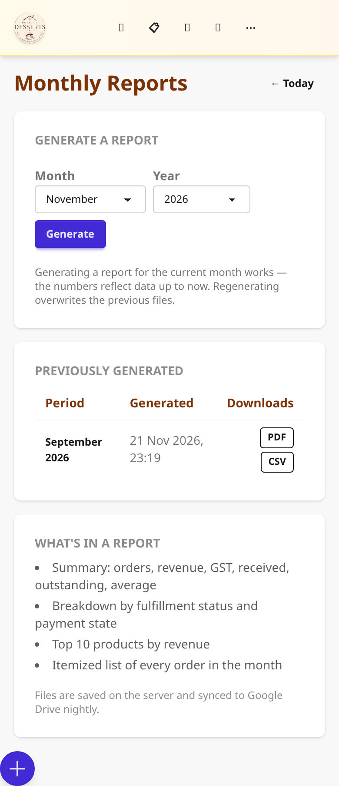
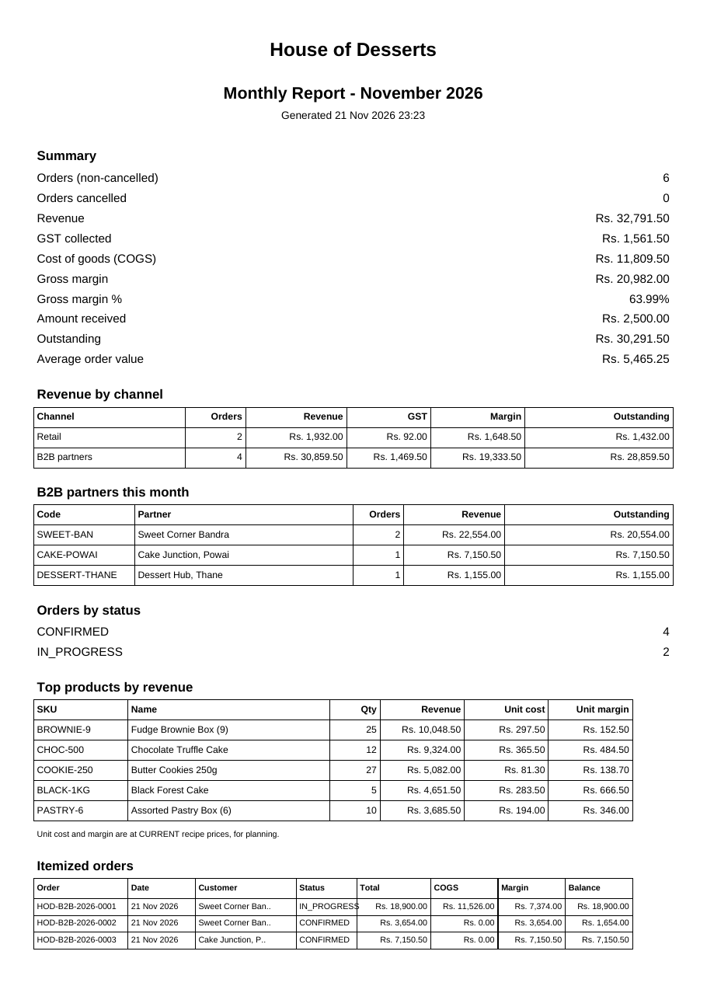
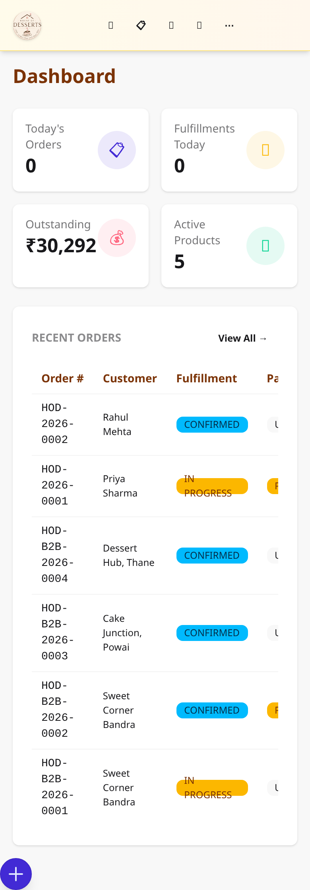
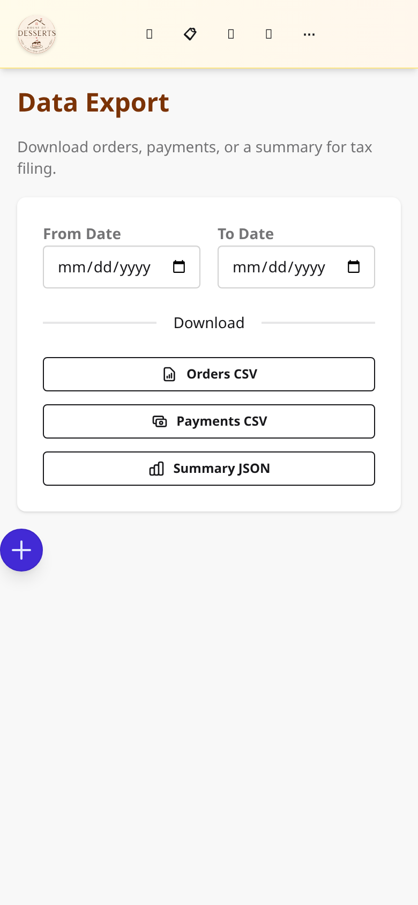

# Reports, export and the audit trail

**Audience:** whoever does the books, or hands them to an accountant.
**Time to read:** 20 minutes. **Time to produce a month:** 2 minutes.
**Prerequisites:** orders and payments recorded during the month — see
[retail orders](retail-orders.md).

> **In one line:** the monthly report is a regenerable summary of one
> month, split by sales channel; the export is the raw data an accountant
> wants; the audit log is the answer to "who changed this?".

---

## Contents

1. [The three tools](#1-the-three-tools)
2. [The monthly report](#2-the-monthly-report)
3. [**How B2B appears in the reports**](#3-how-b2b-appears-in-the-reports)
4. [The dashboard](#4-the-dashboard)
5. [Export](#5-export)
6. [The audit log](#6-the-audit-log)
7. [The month-end routine](#7-the-month-end-routine)
8. [Troubleshooting](#8-troubleshooting)

---

## 1. The three tools

| Tool | Question it answers | Where |
|---|---|---|
| **Monthly report** (PDF + CSV) | How did the month go? | More → 📊 Reports |
| **Export** (CSV + JSON) | Here is the raw data for my accountant | More → 📥 Export |
| **Audit log** | Who changed this, and when? | `/audit` (link is commented out in the nav; reachable by URL) |

All three read the same data. None of them can change it.

---

## 2. The monthly report

Pick a month and **Generate**. Two files appear, and you can regenerate
them as often as you like — they are summaries, not documents:

- `YYYY-MM.pdf` — for reading and printing.
- `YYYY-MM.csv` — for Excel, or for your accountant.

### Reading the summary

| Line | What it means |
|---|---|
| Orders (non-cancelled) | How many orders counted this month |
| **Revenue** | Total invoiced value, GST included |
| **GST collected** | The part of that revenue which is tax, owed to the government |
| **Cost of goods (COGS)** | Ingredient cost consumed by those orders, at the price when baked |
| **Gross margin** | Revenue − COGS. The number that is actually yours before rent, labour and power |
| Amount received | Money that actually arrived |
| **Outstanding** | Invoiced but not yet received |

Revenue and amount received are **not** the same number, and both matter:
one is what you earned, the other is what is in the bank.

### What is in the PDF

Summary · **Revenue by channel** · **B2B partners this month** · Orders by
status · Top products by revenue · Itemized orders.

---

## 3. How B2B appears in the reports

This is the part that changed when the wholesale module was added. The
arrangement, in full:

### 3.1 One report, split by channel

The report does not treat wholesale as a separate set of books. Every
order is in the same month, and one table splits them:

| Channel | Orders | Revenue | GST | Margin | Outstanding |
|---|---|---|---|---|---|
| Retail | 2 | ₹1,932.00 | ₹92.00 | ₹1,648.50 | ₹1,432.00 |
| B2B partners | 4 | ₹30,859.50 | ₹1,469.50 | ₹19,333.50 | ₹28,859.50 |

Why this matters: **GST on a B2B invoice is the buyer's input credit**. Your
GST return asks for the split between B2C and B2B supplies anyway, and a
single blended number cannot answer it. The channel table gives you that
split for the month without a second report.

The two channel rows always add up to the headline revenue — if they ever
did not, that would be a bug worth reporting.

### 3.2 Partner rollup

Under the channel table, one row per partner for the month: orders,
revenue, received, outstanding. That is the list you use to decide who to
call.

### 3.3 Per-partner statements (the day-to-day tool)

The monthly report is the month; the **statement** is the running position:

**Partners → [partner] → Statement** — billed, received, outstanding, one
row per order, **Download CSV**.

This is the document you send to the partner. The monthly report is the
one you keep and file.

### 3.4 Invoices and GST

- **One invoice series** for everyone: `HOD-2026-0001`, `HOD-2026-0002`, …
  A single consecutive series from one GSTIN is compliant and simplest.
- **B2B invoices** additionally carry the partner's **GSTIN** and their
  **PO reference**, so their accounts team can claim input credit and match
  the invoice to their purchase order.
- **Retail invoices** carry no buyer GSTIN, which is correct for B2C.
- Numbers reset each **calendar year**. A GST financial year runs April–March;
  moving the reset to April is a one-line change that must be done at a
  year boundary, never mid-series.

### 3.5 What is *not* in the monthly report

- **Semi-finished or inter-branch transfers** — not modelled.
- **A per-partner GST summary** — the partner rollup plus the itemized CSV
  gives you the raw rows; a dedicated GSTR-1 style export is future work.
- **Credit notes / returns against a partner** — cancel the order and the
  statement reflects it; there is no separate credit-note document.

---

## 4. The dashboard

**More → 📈 Dashboard.**

The at-a-glance version of the same numbers: today's orders, pending
deliveries, outstanding balance, product count, and the ten most recent
orders. It is for a quick look, not for filing. If the dashboard and the
monthly report ever disagree, the report is right — it is computed from a
fixed date range.

---

## 5. Export

**More → 📥 Export.**

Pick a date range and download:

| File | Contents |
|---|---|
| **orders.csv** | One row per order: number, date, **channel**, **partner**, **PO ref**, customer, phone, status, delivery type, subtotal, GST, total, advance, balance, items |
| **payments.csv** | One row per payment: date, order, customer, method, reference, amount |
| **summary.json** | The same totals as the report, in a machine-readable shape |

The orders file carries the channel columns specifically so an accountant
can split retail and wholesale themselves without asking you.

Two date conventions, both deliberate:

- **orders.csv** filters by the **order date** — the business day the order
  was placed.
- **payments.csv** filters by **when the money arrived**.

They can differ, and that is correct: an order placed on the 30th and paid
on the 2nd belongs to two different months for two different purposes.

---

## 6. The audit log

**`/audit`** — not in the nav bar by default (it is commented out in
`base.html`), but the URL works and it is worth bookmarking.

Every significant change is written with the old and new values: order
edits, status changes, payments, product and customer changes, price-list
changes. Filter by entity type with the tabs.

It is **append-only** and it commits in the same transaction as the change
it records, so a change without its audit row cannot exist.

Use it when:

- a number looks wrong and you want to know what changed it,
- a partner disputes a price ("we agreed ₹740, not ₹780") — the price
  snapshot and the audit row settle it,
- you want to see who cancelled an order.

---

## 7. The month-end routine

Fifteen minutes, once a month:

- [ ] **Reports** → generate last month. Keep the PDF.
- [ ] Read the **Revenue by channel** table. Does the B2B share look like
      what you expect? A sudden jump usually means an order was mis-tagged
      as B2B.
- [ ] Read **B2B partners this month**. Anyone with outstanding from two
      months ago gets a call.
- [ ] **Export** → orders.csv and payments.csv for the accountant.
- [ ] Check the summary's **Outstanding** against your bank balance and
      your memory. A big gap is either an unrecorded payment or an
      unrecorded order.
- [ ] Confirm the backup file from the last night exists.

Yearly:

- [ ] Keep all twelve PDFs together — that is your year.
- [ ] Export the full year to CSV and archive it somewhere off the machine.

---

## 8. Troubleshooting

| Problem | Cause | Fix |
|---|---|---|
| Report shows 0 orders for a month that had orders | The order date is in a different month than you think | Check **Order placed on** on the order; the report filters by that date |
| Revenue includes an order you cancelled | Cancelled orders are excluded from revenue but counted in "orders total" | Check `orders_cancelled` in the summary |
| GST total looks low | Products with GST 0% | Check the product's GST rate |
| B2B revenue is missing | Orders were created as Retail by mistake | The channel is set at creation; recreate or accept the mis-tag |
| Partner missing from the rollup | Their orders are outside the month | Widen the period, or use the partner statement |
| Export CSV opens as one column in Excel | Locale list separator | Data → From Text/CSV, choose comma |
| Audit log is empty | Nothing changed yet, or you are looking at the wrong filter | Switch the tab to All |
