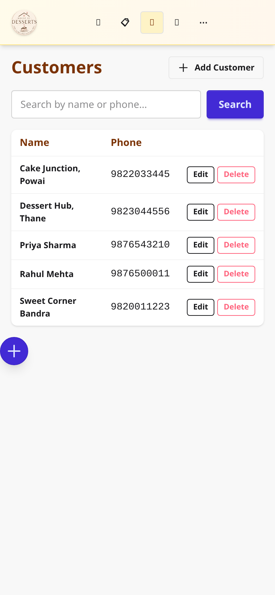
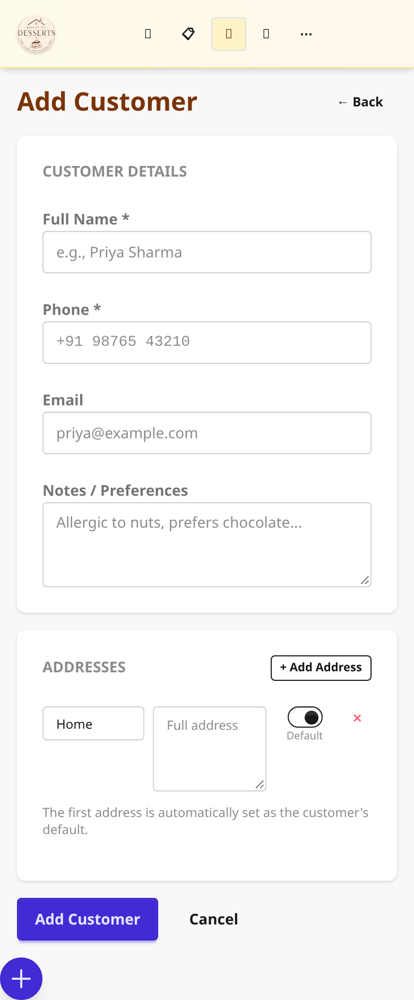
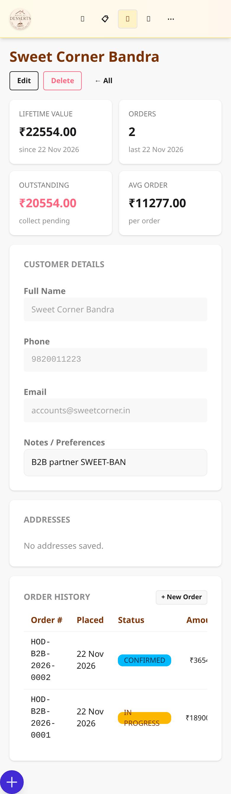
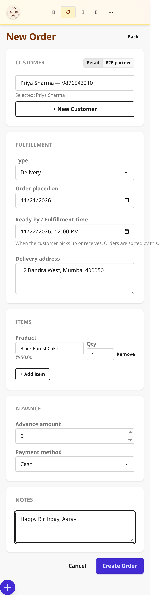
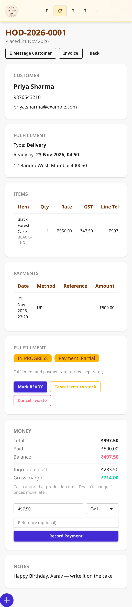
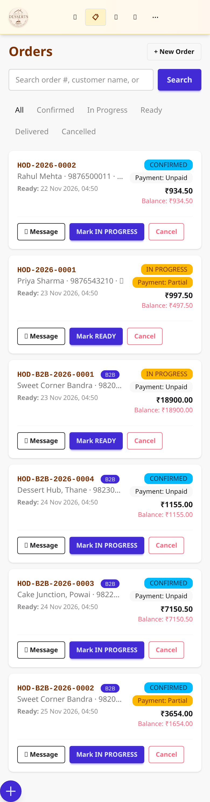

# Retail: customers and orders

**Audience:** anyone taking an order.
**Time to read:** 20 minutes. **Time to take your first order:** 3 minutes.
**Prerequisites:** at least one product must exist (see
[products and inventory](products-and-inventory.md)).

> **In one line:** a customer orders, you bake, you hand it over, you take
> the money. The system tracks the baking and the money separately, on
> purpose.

---

## Contents

1. [The two things that are separate](#1-the-two-things-that-are-separate)
2. [Customers](#2-customers)
3. [Taking an order](#3-taking-an-order)
4. [The status flow](#4-the-status-flow)
5. [Payments](#5-payments)
6. [The invoice](#6-the-invoice)
7. [Editing and cancelling](#7-editing-and-cancelling)
8. [Finding an order again](#8-finding-an-order-again)
9. [Troubleshooting](#9-troubleshooting)
10. [Daily routine](#10-daily-routine)

---

## 1. The two things that are separate

This is the one idea that makes the rest of the app obvious.

| | **Fulfillment** | **Payment** |
|---|---|---|
| Question | Where is the cake? | Where is the money? |
| Values | INQUIRY → CONFIRMED → IN PROGRESS → READY → DELIVERED (or CANCELLED) | Paid / Partial / Unpaid |
| Changes when | you bake and hand over | you record a payment |

Recording a payment never moves the cake. Delivering never marks it paid.
Both appear as separate badges everywhere an order is shown, and they are
labelled so you cannot confuse them: `IN PROGRESS` next to
`Payment: Partial`.

A delivered order with an outstanding balance is a normal state: the cake
is with the customer, the money is not in yet. That is exactly what you
want to be able to see.

---

## 2. Customers

**More → 👥 Customers.**



Each row: name, phone, email, order count, and when they were added. The
search box matches name or phone — a partial phone number works, which is
what you actually have when someone calls.

### Adding a customer

**+ Add Customer**, or **+ New Customer** from inside an order (the mini
form — no need to abandon the order).



| Field | Notes |
|---|---|
| Full name | Required |
| Phone | Required, and **unique among active customers** — the same number cannot be two people |
| Email | Optional |
| Notes | Allergies, preferences, "always orders on Sundays" |

### Addresses

A customer can have several addresses (Home, Office, parents' place), one
marked default. The default address auto-fills the delivery field when you
choose **Delivery** on an order. You can always type over it for a one-off
delivery.

### The customer page



Their full order history, lifetime value, and addresses. **Repeat** on a
past order starts a new order pre-filled with the same items — the fastest
path for a regular.

Deleting a customer is a **soft delete**: they disappear from pickers but
their orders, invoices and history stay exactly as they were.

---

## 3. Taking an order

**Orders → + New Order** (or the **+** button, bottom-right on a phone).



Five cards, top to bottom.

### 3.1 Customer

Type 2+ characters of a name or phone. Tap the result.

The field is a **type-ahead, not a dropdown** — there is no long list to
scroll. If you type a name and do not pick from the list, the order will
not save: that guard exists so a half-typed name never becomes a real
order.

Choosing a customer with a default address and Delivery selected fills the
address for you.

### 3.2 Fulfillment

| Field | Notes |
|---|---|
| Type | Pickup or Delivery. Delivery reveals the address box. |
| Order placed on | Defaults to today. Editable — useful when you enter yesterday's order today. |
| **Ready by** | **Required.** Defaults to tomorrow 12:00. This is the single most important field: every list, the production plan and the WhatsApp messages are sorted by it. |

### 3.3 Items

One row to start; **+ Add item** adds more.

Each row: **product type-ahead** (name or SKU), **Qty**, **Remove**. Under
the product you see its retail price, so you can quote the customer
without leaving the form.

There is no live total on a retail order — the total is computed when you
save, from the price at that moment.

### 3.4 Advance

What the customer paid up front (0 is fine) and how: Cash, UPI, Bank or
Card. This creates a payment record immediately.

### 3.5 Notes

Free text — the message on the cake, allergies, "call before coming".

**Create Order** → you land on the order page.

---

## 4. The status flow



```
INQUIRY → CONFIRMED → IN PROGRESS → READY → DELIVERED
              ↘ CANCELLED (from any step before DELIVERED)
```

| Status | When | What it does |
|---|---|---|
| **INQUIRY** | Someone is asking | Nothing is committed |
| **CONFIRMED** | You have accepted it | Editable from here |
| **IN PROGRESS** | You have started baking | **Deducts ingredients** per the recipe, and fixes the cost of goods |
| **READY** | Baked and packed | Appears at the top of dispatch |
| **DELIVERED** | Handed over | The successful end |

Two rules worth internalising:

- **You cannot skip a step.** CONFIRMED → READY is not offered. The
  sequence is what makes the production and stock numbers true.
- **IN PROGRESS is the trigger for stock.** If you never mark it, your
  ingredients never move and your cost per order is wrong. This is the
  single most common data mistake.

### Cancelling

From IN PROGRESS you get two choices, and they mean different things:

- **Cancel · return stock** — nothing was actually used. Ingredients go
  back, the cost disappears.
- **Cancel · waste** — it was baked and thrown away. The consumption
  stands, so the loss shows up in your cost of goods.

---

## 5. Payments

Open the order, scroll to **Money**:

| Field | Notes |
|---|---|
| Amount | Pre-filled with the exact balance |
| Method | Cash / UPI / Bank / Card |
| Reference | UPI transaction id or UTR — worth thirty seconds, saves an hour later |

**Record Payment** → the balance drops and the payment badge changes.

The order page shows **Total, Paid, Balance**, plus the ingredient cost and
gross margin captured when production started. That margin does not move
if you buy chocolate more expensively next month — it is the cost at the
moment you baked.

**Part payments are normal.** An advance of ₹500 on a ₹997.50 order leaves
`Payment: Partial` and a balance of ₹497.50.

---

## 6. The invoice

**Invoice** on the order page.

The invoice is a **snapshot**. It freezes the customer's details, the
items, the prices and the GST at the moment you issue it. Editing the
order afterwards does **not** change an issued invoice — that is a
deliberate feature, because an invoice is a tax document, not a view.

- **Download PDF** — the printable tax invoice.
- **Print Receipt** — a thermal receipt, if a printer is configured.

GST is shown per line at the product's rate (5% for most bakery items).
The invoice header carries your GSTIN and FSSAI number from
**Settings**.

---

## 7. Editing and cancelling

**Edit** appears while the order is **CONFIRMED**:

- Change the ready-by time, delivery type and address, notes, and items.
- Payments already recorded are untouched.
- The total cannot be reduced below what has been paid.
- Every change is written to the audit log with old and new values.
- If an invoice exists, it is not updated — issue a fresh one if needed.

Once the order is IN PROGRESS it is locked. Cancel and recreate, or note
the change.

---

## 8. Finding an order again



The search box on **Orders** matches:

- the order number (`0007` finds `HOD-2026-0007`),
- the customer's name,
- the customer's phone (partial is fine).

Filter tabs narrow by status. On a phone the tabs wrap onto two lines —
that is expected.

---

## 9. Troubleshooting

| Problem | Cause | Fix |
|---|---|---|
| "Create Order" does nothing | A row has a product name typed but not picked from the list | Pick from the suggestions; the field turns red |
| Customer not found | Fewer than 2 characters, or the customer is inactive | Type more, or re-create the customer |
| "Phone is already registered" | That number belongs to another active customer | Search by phone and use that customer |
| Stock did not go down | The order never reached IN PROGRESS | Mark it; consumption happens there |
| Balance looks wrong | A payment was recorded against the wrong order | Check the payments table on both orders; correct with a refund or an adjustment |
| Invoice shows old details | It is a snapshot | Issue a new invoice after the correction |
| Cannot edit | The order is past CONFIRMED | Cancel and recreate, or note the change |

---

## 10. Daily routine

- [ ] Morning: **Today** → dispatch list. Any red balance is money to
      collect at handover.
- [ ] Every order you start baking: **Mark IN PROGRESS**.
- [ ] Every payment as it arrives: **Record Payment**, with a reference.
- [ ] Every handover: **Mark DELIVERED**.
- [ ] Evening: any order still CONFIRMED for today — move it or accept
      that it becomes Overdue tomorrow.
