# Screen tour — every tab in the app

**Audience:** a first-day walkthrough, or a reminder of where something lives.
**Time to read:** 10 minutes. **Prerequisites:** none.

> **In one line:** four tabs on the top bar, everything else under **More**,
> and every list screen has its own filter tabs. This chapter is the map.

---

## 1. The navigation bar

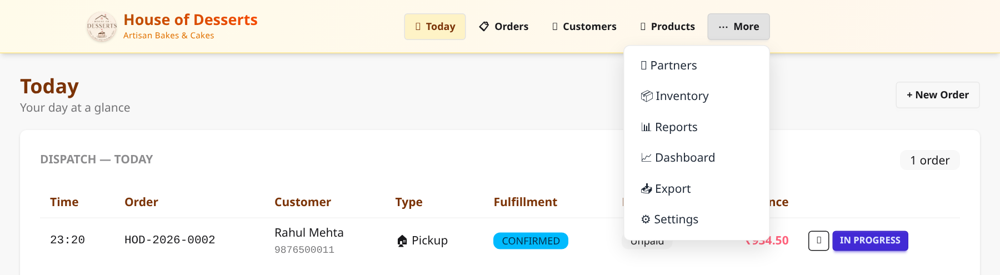

There are only four buttons on the top bar, because those are the four
things a bakery touches every day:

| Tab | URL | What it is for |
|---|---|---|
| **Today** | `/today` | The home screen. Dispatch, production, low stock |
| **Orders** | `/orders` | Every order, search, status filter |
| **Customers** | `/customers` | The people who buy |
| **Products** | `/products` | What you sell, and what it costs |

Everything else is behind **⋯ More**:

| Menu item | URL | What it is for |
|---|---|---|
| **🏪 Partners** | `/b2b` | Shops and franchisees you supply |
| **📦 Inventory** | `/ingredients` | Ingredients, stock, purchases |
| **📊 Reports** | `/reports` | The monthly report (PDF + CSV) |
| **📈 Dashboard** | `/dashboard` | At-a-glance numbers |
| **📥 Export** | `/export` | Raw CSV/JSON for an accountant |
| **⚙️ Settings** | `/settings` | Business identity, GSTIN, printer, numbering |

There is one more screen that is not in the menu at all: the **Audit Log**
at `/audit`. Bookmark it — it is the answer to "who changed this?".

On a phone the four top tabs collapse to icons and the **+** button in the
bottom-right corner is always a new order.

---

## 2. Today — the home screen

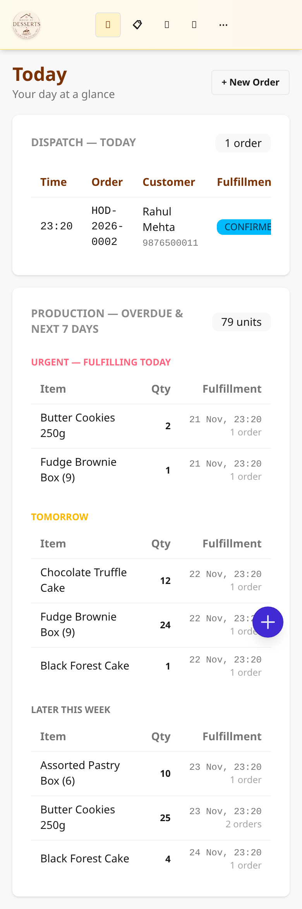

The first screen of the day. Three cards: **Low stock** (only when
something is short), **Dispatch — Today**, and **Production — Overdue &
Next 7 Days**.

Full detail: [user manual §2](../USER_MANUAL.md#2-today--the-home-screen).

---

## 3. Orders — and its filter tabs

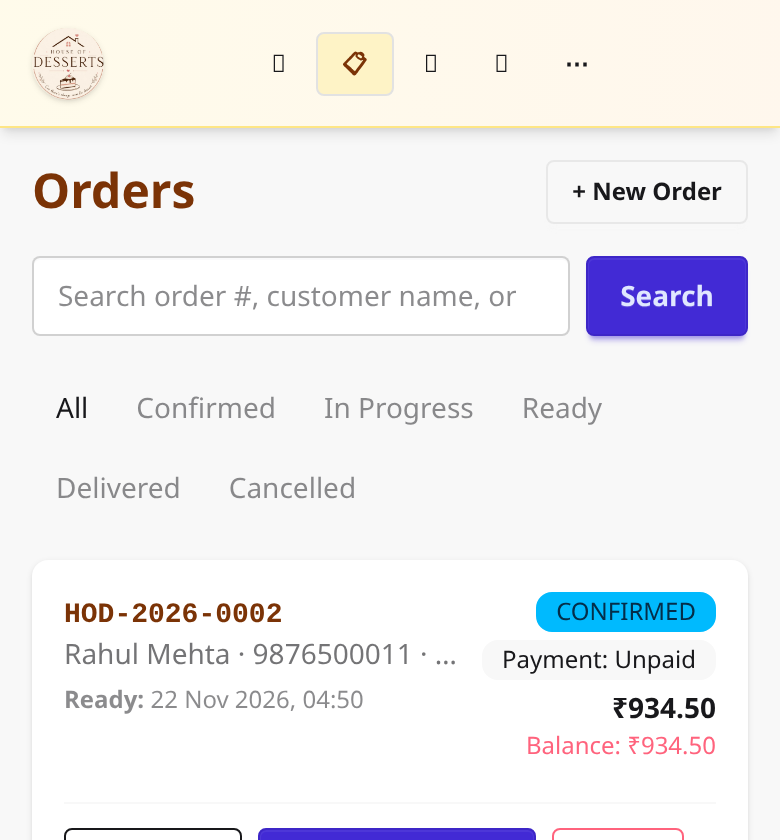

Every order, newest-relevant first. The **filter tabs** under the search
box are the fastest way to answer "what is in the oven?":

`All · Confirmed · In Progress · Ready · Delivered · Cancelled`

On a phone the tabs wrap onto two lines — that is expected, not a bug.

Each card carries the two badges that matter: fulfillment status and
payment status, side by side and clearly labelled.

Full detail: [retail orders](retail-orders.md).

---

## 4. Customers

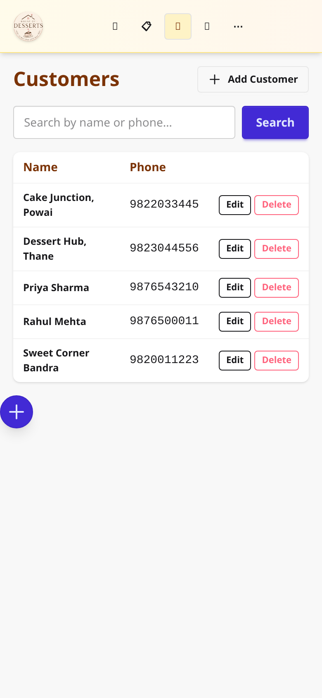

Name, phone, order count, when they joined. Search by name or a partial
phone number.

Full detail: [retail orders §2](retail-orders.md#2-customers).

---

## 5. Products

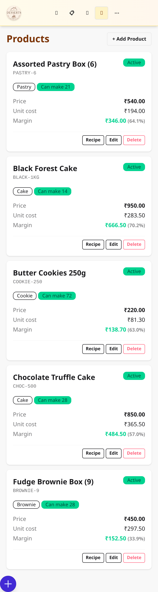

Every product as a card: SKU, price, unit cost, margin. The margin comes
from the recipe — a product with no recipe shows 100%, which means "no
recipe yet", not "free".

Full detail: [products and inventory](products-and-inventory.md).

---

## 6. Partners — the B2B tab

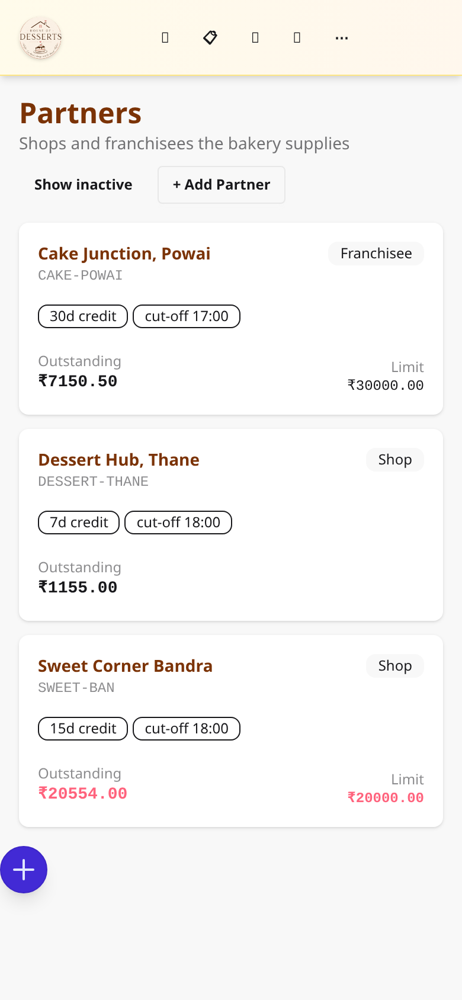

Shops and franchisees, with their credit position. Empty until you add a
partner; retail is unaffected either way.

Full detail: [selling to shops and franchisees](b2b-partners.md).

---

## 7. Inventory

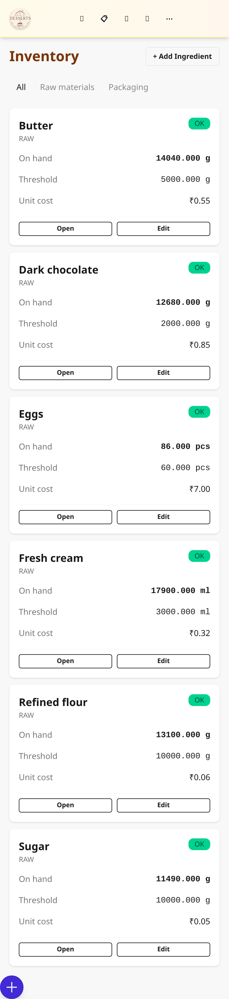

Every ingredient with stock on hand, reorder threshold and cost. Anything
at or below its threshold is flagged here and on the Today page.

Full detail: [products and inventory §4](products-and-inventory.md#4-ingredients-and-stock).

---

## 8. Reports

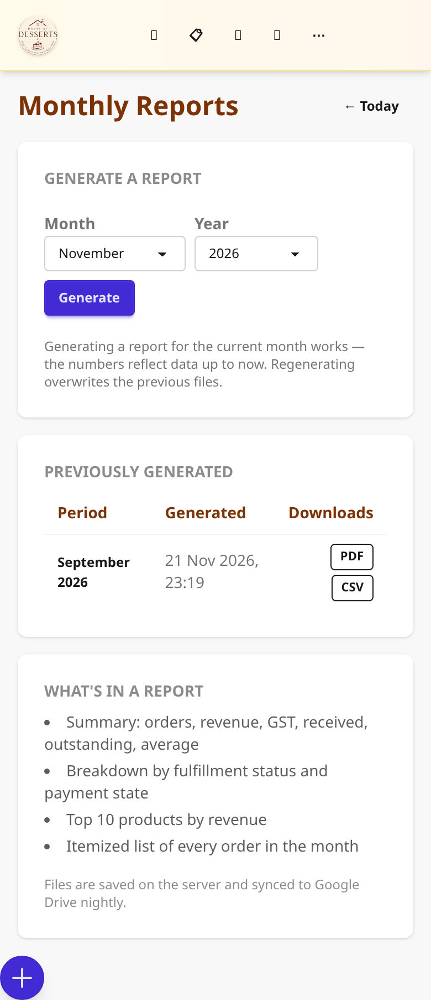

Pick a month, generate a PDF and a CSV. The report is regenerable — it is
a summary, not a document you must keep safe.

Full detail: [reports and export](reports-and-export.md).

---

## 9. Dashboard

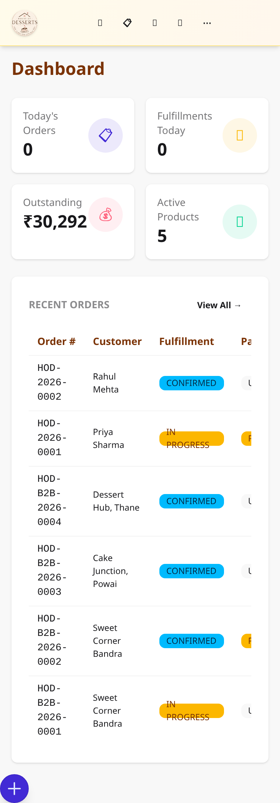

Today's order count, pending deliveries, outstanding balance, product
count, and the ten most recent orders. For a glance, not for filing.

---

## 10. Export

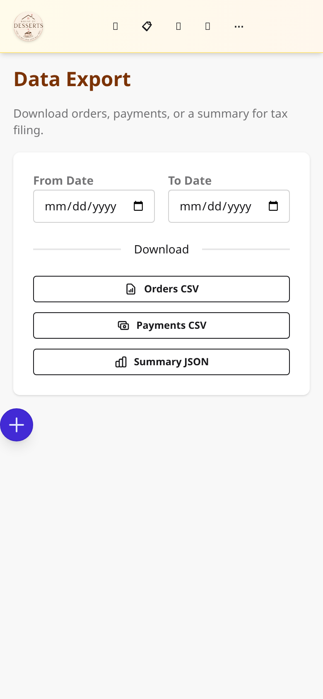

Date range → `orders.csv`, `payments.csv`, `summary.json`. The orders file
carries channel, partner and PO reference columns, so an accountant can
split retail from wholesale.

---

## 11. Settings

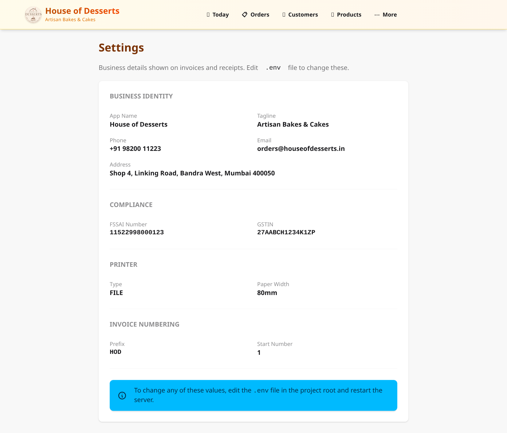

Read-only in the app: business identity, FSSAI and GSTIN, printer, invoice
numbering. These come from the `.env` file and need a restart to change —
deliberate, because they appear on every invoice you have ever issued.

---

## 12. Audit log

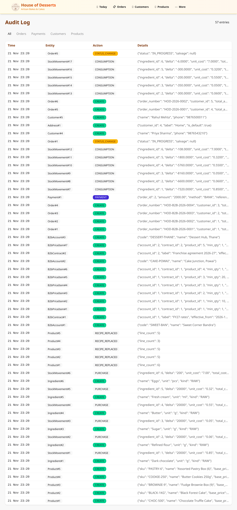

Every significant change with old and new values, newest first. The **tabs
across the top** filter by entity: `All · Orders · Payments · Customers ·
Products`.

This is where you look when a number surprises you — an order edit, a
status change, a price-list change, a payment. Append-only, and written in
the same transaction as the change it records.

---

## 13. The tabs, in one place

| Kind of tab | Where | What it does |
|---|---|---|
| **Top navigation** | Every screen | Today / Orders / Customers / Products, plus More |
| **Status filter tabs** | Orders | Narrow the list by fulfillment status |
| **Entity tabs** | Audit log | Narrow the log by what changed |
| **Segmented toggle** | Order form | Retail vs B2B partner |
| **Payment terms** | Order form (B2B) | Credit / Advance / COD — a dropdown, not a tab |
